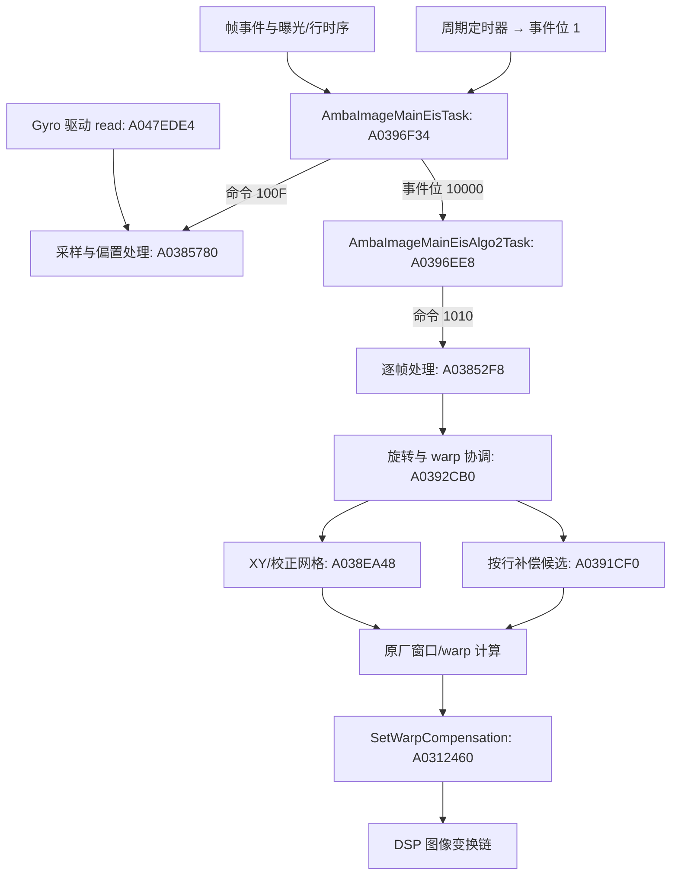

# YI 4K 原厂 EIS 实现定位

2026-11-09更新：已对用户1.10.7真机镜像逐项核对本报告的核心入口，并取得只读RTOS DRAM快照；完整范围与限制见 [本机验证记录](device-1107-eis-validation.md)。下文保留旧样本分析身份，不能整体套用为真机写入地址表。

## 结论与适用范围

**已找到明确的 EIS 控制器、原始 gyro 采集入口、采样/偏置处理、帧时序同步、旋转计算、逐网格补偿及 DSP warp 提交链。** 这是对前一轮通用 warp 调查的进一步专项分析：可以开始研究保留原厂传感器与硬件处理链、替换 ARM 侧运动估计和轨迹平滑算法的方案。

目前没有完整恢复全部算法方程、参数单位、结构体与并发协议，也没有在相机上运行。不能据此保证已经可以移植现代算法，或解释用户看到的所有防抖问题。

样本为普通 YI 4K/Z16 的公开社区 v1.10.52；RTOS 内部构建字符串为 `Z16V13L_1.10.9_build-20180622051856_git-efbdfd85_r2748`。所有地址仅对应 RTOS SHA-256：

`c1cde4bcd290bdfac9f48ad5eb04f20bc3d208dd1e041ac1376b255dcf846141`

下表中的名称以日志和控制流重建，并非恢复了原厂符号表；链接均为已有 Ghidra 伪代码，伪代码不是源码。

## 实际链路



这是从直接调用、命令分发和驱动表拼出的静态链路。主采样函数还包含更多状态更新和 DSP 同步分支；不能把图中两任务理解为全部工作严格隔离。DSP 后续管线与编码时序还需独立恢复。

## 已定位的核心函数

| 实现 | 地址与证据 | 已观察到的行为 |
|---|---|---|
| EIS 主任务 | [0xA0396F34](../artifacts/rtos-reverse/full/decompiled/a0396f34.c) | 初始化、启停、等待事件、接收帧时间与曝光信息、驱动采样和逐帧任务 |
| 主任务创建 | [0xA03975BC](../artifacts/rtos-reverse/full/decompiled/a03975bc.c) | 明确使用 `AmbaImageMainEisTask` 名字；栈参数为 0x2000 |
| 第二算法任务 | [0xA0396EE8](../artifacts/rtos-reverse/full/decompiled/a0396ee8.c) | 等待事件位 0x10000，调用图像命令 0x1010 |
| 第二任务创建 | [0xA0397688](../artifacts/rtos-reverse/full/decompiled/a0397688.c) | 名字为 `AmbaImageMainEisAlgo2Task`；栈参数为 0x2000 |
| 任务生命周期 | [EIS 任务生命周期](device-1107-eis-task-lifecycle.md) | `TaskCreate(auto_start=0)` → `TaskSmpCoreExclusionSet(~3)` → `TaskResume`；两个任务均使用 0x2000 栈 |
| 控制器初始化 | [0xA037D9E0](../artifacts/rtos-reverse/full/decompiled/a037d9e0.c) | 读 gyro 描述信息，建立焦距与最大角度相关量 |
| 模式初始化 | [0xA037FE20](../artifacts/rtos-reverse/full/decompiled/a037fe20.c) | 读取 sensor 模式、RowTime、FrameLengthLines、裁切和 warp 信息，设置采样环和 ucode gyro delay |
| Gyro 标定/参数 | [0xA037F55C](../artifacts/rtos-reverse/full/decompiled/a037f55c.c)、[0xA037F8BC](../artifacts/rtos-reverse/full/decompiled/a037f8bc.c) | 使用偏置、X/Y/Z 灵敏度、像元尺寸与换算因子 |
| 采样与运动处理主体 | [0xA0385780](../artifacts/rtos-reverse/full/decompiled/a0385780.c) | 调 gyro read，写 X/Y/Z 环形数组，维护偏置与帧对应关系，处理运动和 DSP 更新状态 |
| 逐帧处理 | [0xA03852F8](../artifacts/rtos-reverse/full/decompiled/a03852f8.c) | 正常路径调用 0xA0392CB0，含测试旋转分支及超时检测 |
| 旋转与 warp 协调 | [0xA0392CB0](../artifacts/rtos-reverse/full/decompiled/a0392cb0.c) | 对 Z 轴样本减偏置、累积、滤波/限幅，调用网格生成、窗口计算和 warp 提交 |
| 旋转滤波候选 | [0xA0384710](../artifacts/rtos-reverse/full/decompiled/a0384710.c) | 常见分支为 `previous*99/100 + input*gain/100`，另有小运动计数、自适应系数和限幅 |
| XY/校正网格生成 | [0xA038EA48](../artifacts/rtos-reverse/full/decompiled/a038ea48.c) | 写入成对的 int16 网格值，叠加平移及校正表，含透视校正分支 |
| 按行补偿，RSC 候选 | [0xA0391CF0](../artifacts/rtos-reverse/full/decompiled/a0391cf0.c) | 积分 X/Y gyro、按网格行插值、限幅，再把每行不同的补偿叠加进网格；符合滚动快门校正结构 |
| 变换输出 | [0xA0312460](../artifacts/rtos-reverse/full/decompiled/a0312460.c) | 已有报告确认复制 warp 表、clean D-cache、进入 DSP 控制链 |
| EIS 调试控制 | [0xA0394CC0](../artifacts/rtos-reverse/full/decompiled/a0394cc0.c) | 控制旋转、透视、RSC 相位、范围、焦距、日志与测试模式等；不等于所有开关当前启用 |

MCTF 是独立的时域降噪/运动补偿相关链，不能把它的名字当作已找到防抖算法的证据。上表 EIS 链路有独立任务名、日志、分发编号及直接调用支持。

## Gyro 驱动已不止是 chip_id

启动代码 [0xA018756C](../artifacts/rtos-reverse/full/decompiled/a018756c.c) 把全局 `0xA1A355A4` 指向 `0xA078B0BC` 的操作表。本次直接从镜像读取该表，并反汇编间接入口：

| 操作表偏移 | 指针 | 静态识别 |
|---|---|---|
| +0x00 | 0xA047F2A0 | 获取/初始化约 0x3E 字节设备描述信息 |
| +0x04 | 0xA047F0F8 | 打开/配置 IMU；通过 SPI 读 ID，期望值为 0xD1，失败打印 Bosch gyro 错误 |
| +0x08 | 0xA047EDE4 | 读数据；EIS 使用 `(1, out)` 分支读取 gyro |
| +0x0C | 0xA047ED64 | 读寄存器候选，已有 chip_id 命令调用依据 |
| +0x10 | 0xA047ED20 | 写寄存器候选 |

`0xA047EDE4` 的 mode=1 分支通过 `0xA048E12C` 读取 7 字节，拼出三个 16 位分量，按配置可能交换 X/Y，并加设备描述中的 level shift 后写入 `out+0/2/4`。所以输出不能直接当作未经处理的物理角速度或套用 int16/dps；还要结合极性、灵敏度与偏置换算。设备 ID 和配置序列与 Bosch BMI160 相符，具体芯片仍以实物/完整寄存器证据为准。

该 read 入口通过函数指针引用，**前一轮自动函数索引没有识别它**。本次另存了 [原始汇编](../artifacts/rtos-reverse/eis/a047ede4.asm)，没有伪造一份缺失的 Ghidra 反编译。操作表与原始字节关系见 [evidence.json](../artifacts/rtos-reverse/eis/evidence.json)。这也是自动反编译数量不代表完整覆盖的具体例子。

## 调度、帧同步和 DSP 截止时间

主任务创建周期定时器时传入两个 `1000`；回调 `0xA03974C4` 设置事件位 1。任务收到该位后发命令 `0x100F`，进入采样处理。固件调试字符串把这一路称为 `1ms task`，但定时器单位、调度抖动和 IMU 实际输出频率尚未实测。

另外两个帧事件注册 ID 为 `0x1A`、`0x1C`，回调分别是 `0xA0397500`、`0xA03974D4`；它们记录时间并设置位 4/8。主任务分别发送 `0x100E`、`0x100D`。对应接收函数 [0xA037BA48](../artifacts/rtos-reverse/full/decompiled/a037ba48.c) 和 [0xA037B998](../artifacts/rtos-reverse/full/decompiled/a037b998.c) 中日志明确使用 SOF/EOF 名字。应结合 DSP 事件定义核实具体硬件时刻，不能只依赖这些名字。

[图像命令分发器 0xA03B0CE0](../artifacts/rtos-reverse/full/decompiled/a03b0ce0.c) 直接建立以下映射：

| 命令 | 目标 |
|---|---|
| 0x1000 / 0x1001 | EIS enable / disable：0xA0382F88 / 0xA0382BA0 |
| 0x1002 / 0x1003 | 控制器初始化 / 模式初始化 |
| 0x100D / 0x100E | EOF / SOF 相关时间输入 |
| 0x100F | 采样与运动处理主体：0xA0385780 |
| 0x1010 | 逐帧算法入口：0xA03852F8 |
| 0x1012 | 选择处理 mode 0/5：0xA03835C4 |
| 0x10FF | EIS 调试控制：0xA0394CC0 |

mode 0/5 是固件处理路径编号，不应未经确认解释成“五轴防抖”或用户菜单模式。

逐帧函数会测量计算耗时，并有 `Eis-Warp calculation not in-time for ucode`；主体还有 `Warp content not ready last frame`。`EIS_UPDATE_ADV_TIME`、`EIS_WARP_UPDATE_ADV_TIME` 和 `gyro_delay` 都参与时序。**替换算法必须按原厂时限提交正确帧的表，单次 calc/set 成功不代表可以逐帧稳定录像。**

## 哪些能力可以成为二开基础

### 本轮补充：采样窗口到 warp 表的中间契约

继续沿 `A0385780 → A037C5A4 → A038EA48 → A0312460` 静态追踪后，可以把几个边界再收紧：

- `A037C5A4` 以环形槽位的起止索引遍历 `raw X/Y − bias X/Y`，把窗口内的样本累计或按配置求平均，再把结果写入 `A17039D8/A1703BFC` 两组辅助数组；它还返回当前帧的运动/窗口中间量给上层。
- `A038EA48` 将最终位移/校正叠加到 16 位成对网格元素。网格的实际宽高由 `A170464C/A1704650` 参与计算；当前证据足以确认元素格式和循环方向，尚不足以把两个数直接命名为完整 DSP 网格尺寸。
- `A0312460` 在提交前按两个 0x1800 字节区域复制 X/Y warp 数据，执行缓存维护并进入 `AmbaDSP_ImgSetWarpCompensation` 相关控制链。`0x1800` 是本函数的复制长度，不等价于已恢复的网格宽高或全部 DSP 缓冲大小。

这条边界说明了替换算法必须遵守的接口：输入是经过偏置/定点处理的环形窗口，输出是固定格式的 X/Y 网格和提交时序；不能只替换一个滤波函数后把浮点像素坐标直接交给 DSP。上述结论仍是静态证据，尚未在本机执行自定义输出。

| 方向 | 当前证据支持程度 | 仍缺少的内容 |
|---|---|---|
| 调整范围、旋转强度、延迟、轴极性等 | 有实际状态写入与算法消费入口 | 参数单位、安全范围、模式重建时机、真机效果 |
| 换运动滤波/相机轨迹平滑 | 已定位采样、偏置、Z 轴积分及滤波候选 | X/Y 完整控制方程、定点格式、状态与并发所有权 |
| 自己生成 warp 网格并交给硬件 | 原厂算法确实如此提交，路线有直接证据 | 网格坐标/精度、表切换、cache、帧号/时限、原厂竞争写入 |
| 改进滚动快门校正 | 有按行 gyro 积分和网格修正实现 | 行时序标定、曝光相位与 sensor 模式映射 |
| 移植完整现代实时 EIS | 有输入、计算、硬件输出三个接入点 | loader/hook、完整 ABI、CPU/内存预算、算法适配和长期验证 |

`t app test EIS_enable` 走应用回调，`set_EIS_range` 也有设置链；0x10FF 调试分发器包含更多控制。但目前没有把完整 Shell→调试入口的语法和运行前提全部核实，因此不提供未经验证的相机命令作为操作步骤。

更现实的开发边界是：保留原厂 SPI/IMU、sensor 时序、DSP 重采样和编码管线，在 ARM RTOS 侧逐步替换运动轨迹与网格计算。不能据此承诺达到新机防抖水平；视角余量、曝光运动模糊、IMU 噪声与时间同步也会限制效果。当前证据尚未证明存在可直接迁移的完整现代四元数/轨迹优化实现。

## 下一步可执行的研究顺序

结合 DJI、GoPro、Insta360、Gyroflow 与论文的选型，以及用户反馈的“EIS 关闭后果冻基本消失”，见 [实时算法调查与果冻专项优先级](eis-algorithm-survey.md)。应先检查时序、按行补偿与网格形变，再评估加强平滑。

1. **恢复输入数据契约**：设备信息 0x3E 字节结构、gyro 的量程/灵敏度/极性/level shift、各模式采样频率；记录 raw 与校正后样本的对应关系。
2. **完整恢复时间轴**：SOF/EOF、曝光中点、RowTime、gyro_delay、额外相位、DSP 提交截止时间，明确 mode 0/5 的区别。
3. **恢复算法边界**：从 0xA0385780 的 X/Y 输出和 0xA0392CB0 的 Z 轴/网格路径恢复定点单位、限幅和裁切约束，建立可在主机回放的参考实现。
4. **原生执行与只读观测**：先完成通用报告中的 loader/hook 验证，再在不阻塞实时任务的条件下捕获 gyro、时戳、补偿量、warp 表和提交状态。只读捕获也需要确定缓冲区所有权。
5. **逐项替换**：先保持原厂轨迹和表不变建立基线，再替换滤波，最后替换轨迹/网格生成；比较画面抖动、裁切、畸变、掉帧和提交超时。

本次没有制作 payload、刷写镜像或在相机上开启调试。专项证据可复现：

```sh
.venv-reverse/bin/python scripts/rtos_eis.py
python3 scripts/rtos_query.py function 0xA0385780
python3 scripts/rtos_query.py callees 0xA0392CB0 --limit 80
```

导出的 A32 窗口可能包含 literal pool 和相邻函数，不能把线性解码结果当作全部函数边界证明。原有 [二开手册](rtos-reverse-engineering.md) 中的版本限制与首次原生执行缺口仍适用。
