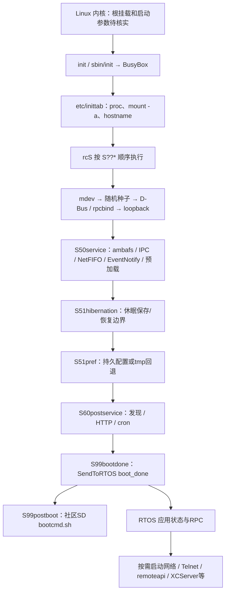
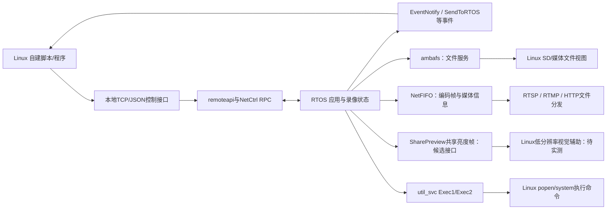

# YI 4K Linux 系统：组成、启动、跨系统通信与二开边界

分析日期：2026-11-05。结论基于升级包拆解、文件清单、内核编译配置、脚本、ELF 导入/导出和重点 ARM 指令分析；未连接相机、未运行目标程序。

2026-11-09补充：[真机首轮采集](../artifacts/device/2026-11-09-linux/README.md) 已完成，实体机是1.10.7，Linux内存/端口/挂载已实测。本文主体仍是较早社区样本的静态报告，不能用它覆盖真机差异。最新的远端处理器、rpmsg 端点和用户空间 RPC 对齐见 [1.10.7 真机通道核对](device-linux-rpmsg-validation.md)。

后续已解包本机RFS（1,192个普通文件、834个符号链接、244个ELF），核对实际libambaipc调用ABI，完成SharePreview服务查询与RTOS只读DRAM快照。结果和缓存可见性限制见 [1.10.7专项记录](device-1107-eis-validation.md)。当前SharePreview服务未找到，不能直接当成可用取帧通道。

**Linux 已有完整的网络、文件共享、媒体分发、RPC 和脚本环境，可以承担控制、观测、传输和部分视觉辅助。实时采集、EIS 与 DSP warp 的主控制仍在 RTOS。两边通过 AmbaLink/RPC、事件和共享内存协作，不能把 Linux root 权限直接等同于可调用任意 RTOS 函数。**

## 1. 本次实际分析了什么

样本是社区 `firmware_1.10.52.bin`，不是从用户相机读取的原厂映像。

| 部件 | 文件 | SHA-256 |
|---|---|---|
| Linux 内核 | `_part_lnx.a9s`，5,762,864 bytes | `d2a56ebe33f42866466b37b4a8ac29cf79a5c60c035ea776c431567ddeec1f7f` |
| Linux 根文件系统 | `_part_rfs.a9s`，28,516,352 bytes | `43f69b3148b143bec882c3de4f2601be9f75a7b652f2e4ef07da4289a3efc1f7` |
| Linux 设备树 | `_part_fdt.a9s` | `3c0ecea9d98f0f60051811bbf58a41ab049f73335b53eafb70cedf9a28454e9f` |
| 配套 RTOS | `_part_lrtos.a9s` | `c1cde4bcd290bdfac9f48ad5eb04f20bc3d208dd1e041ac1376b255dcf846141` |

实际拆出的根文件系统包含 **1,191 个普通文件、832 个符号链接、133 个带 shebang 的脚本、245 个 ELF**。普通文件总内容约 52.12 MiB；压缩文件系统内容约 27.19 MiB。ELF 中有 88 个 ET_EXEC、121 个 ET_DYN、36 个 ET_REL，包含用户程序、共享库、Python 扩展与内核模块，不应把 245 都称作应用程序。

拆包时未在宿主创建 `/dev/console` 和 `/dev/null` 两个设备节点，其余文件、目录和链接已提取；原始节点和权限可查 SquashFS listing。扫描未跟随目标文件系统的绝对链接到宿主。

这是一轮系统各层的静态盘点与重点链路分析，**并非把所有 Linux 内核和应用程序逐函数完整反编译**。完整文件/ELF清单见 [分析索引](../artifacts/linux-analysis/README.md)。

## 2. 哪些属于社区增量

将拆出的每个文件内容和链接目标按 Git blob SHA-1，与仓库标注“Add original rootfs from 1.10.9 firmware”的初始导入提交 `7a5e134d8078f5ca0fad40539cd3954ff290d7f1` 比较，得到：

- 1,992 项内容相同，23 项修改，8 项新增，11 项在样本中未出现。
- Python 2.7、gdbserver、strace、SendToRTOS/RecvFromRTOS、SharePreview 示例、FFmpeg 库、XCServer 等与初始导入内容相同。
- `S99postboot`/`bootcmd.sh` 钩子、Yi4kAPI 包与 `cmdyi.py`、`g_ether.ko`、Wi-Fi 检查脚本是相对该导入的新增。
- 网络、USB、RTMP 和若干 init 脚本有修改。

社区 release 说明交叉支持：v1.10.50 增加 bootcmd/events；v1.10.51 增加 USB 网络；v1.10.52 重写网络/RTMP并更改默认IP。这里的“原厂基线”是**仓库作者标注的导入**，尚未用独立取得并认证的官方固件逐字节验证；Git 也不保留设备节点和真实属主。本次比较只证明内容关系，不证明原厂固件的运行状态。

证据：[逐文件比较](../artifacts/linux-analysis/baseline-comparison.json)、[初始导入 tree](../artifacts/linux-analysis/provenance/initial-import-tree.json)、[release 说明](../artifacts/linux-analysis/provenance/releases.json)。

## 3. 内核与运行环境

| 项目 | 样本证据 | 二开含义 |
|---|---|---|
| 内核 | Linux `3.10.71`，`#1 PREEMPT`，2018-06-22，GCC 4.9.2/Linaro | Linux 的可抢占配置不等于 EIS 的硬实时保证 |
| 用户空间 | Buildroot `2015.05-gefbdfd8`，BusyBox `1.23.2` | 是嵌入式系统，init 与 Shell 主要来自 BusyBox |
| libc/ABI | glibc `2.19-2014.08`；ARM EABI hard-float，解释器 `/lib/ld-linux-armhf.so.3` | 自建 Linux 程序需匹配 ARMv7/armhf、旧 libc 和库依赖 |
| Shell | `/bin/sh -> busybox`；没有 `/bin/bash` | 不应把桌面 Bash 脚本直接当可运行；现有脚本也有需审查的兼容问题 |
| Python | Python 2.7；构建路径含 `python-2.7.9`，有标准库及若干原生扩展 | 适合低频控制、事件和记录；没有发现 Python 3/NumPy/OpenCV/SciPy |
| 编译/软件管理 | 未发现 gcc/g++ 编译器、apt/opkg | 通常在电脑交叉编译，再复制程序与必要依赖 |
| 调试 | 有 gdbserver、strace、ipcinfo、rpcinfo、iperf、iozone 等 | 可以研究 Linux 用户进程与 IPC；不是 RTOS 调试器 |
| 媒体库 | FFmpeg `2.6.2` 的 libavcodec/libavformat/libavutil 等 | 有编解码/封装库；没有发现 ffmpeg/ffprobe 命令行程序 |

一个清单异常：`/usr/bin/rpcgen` 是 **x86-64 ELF**，与初始导入相同，不能作为可在 ARM 相机直接运行的工具。它也说明“文件存在”不足以证明可执行。

内核的 gzip IKCONFIG 从原始内核偏移 `0x400908` 恢复，完整保留为 [kernel.config](../artifacts/linux-analysis/kernel.config)。主要配置：

- ARMv7、MMU、VFPv3、NEON、PREEMPT；AmbaLink multiple-core、RPC、RFS、RPMsg，ambafs 为模块。
- **未启用通用 I²C、SPI、IIO 和 MEDIA_SUPPORT**。因此不能预设 Linux 已有 `/dev/video0`、V4L2 取帧或标准 IIO 陀螺仪接口；RTOS 仍可独立使用这些硬件。
- `CONFIG_RPMSG_RSH` 未启用；存在 RPMsg 不能直接推定有远程 RTOS Shell。
- 有模块卸载、debugfs、kallsyms、IKCONFIG_PROC；Kprobes/Ftrace 未启用，不能直接套常见内核追踪流程。
- `CONFIG_AMBARELLA_HEAPMEM/DSPMEM` 说明有专用内存设施；不等于提供了通用 GPU/NPU 或第三方 DSP 算法加载接口。

## 4. 从开机到服务运行

升级包提供 BST/BLD、RTOS、Linux、设备树和 RFS 等独立部件。Linux 何时被唤起、bootargs如何补写、休眠映像如何选择，仍需启动器/真机日志验证；下面是已恢复的 Linux 用户空间顺序。

`/init` 脚本存在，并处理 devtmpfs、可选 NFS root、控制台和 `/sbin/init`；但仅凭文件存在，不能证明实际启动每次经过 `/init`，而非由内核直接选 `/sbin/init`。`/etc/inittab` 还配置控制台 Shell 的 respawn，没有 systemd。

**休眠不能略过：** `S51hibernation` 是指向 `/usr/local/share/script/ambernation.sh` 的有效绝对链接。脚本 sync/drop caches 后写 `/sys/power/state=disk`；冷启动、休眠镜像生成和恢复路径可能不同，不能假定每次开机都会重新完整执行所有钩子。

详细顺序、行号和条件见 [启动分析](../artifacts/linux-analysis/boot-findings.md)。

## 5. 文件系统和存储究竟由谁管理

`_part_rfs.a9s` 实际是 SquashFS v4/LZO。`fstab` 中 `/dev/root / ext2 rw,noauto` 是模板条目，不足以证明实际根目录为可写 ext2。`/tmp`、`/dev/shm` 配置为 tmpfs，`/var/log`、`run`、`spool` 等很多路径链接到 `/tmp`，通常属于易失运行数据；最终以真机挂载结果为准。

| Linux 路径 | 脚本请求的来源 | 含义 |
|---|---|---|
| `/tmp/FL0` | `mount -t ambafs a:` | 访问 RTOS A盘视图 |
| `/tmp/SD0` | `mount -t ambafs c:` | 访问 RTOS C盘/SD卡 |
| `/tmp/DCIM` | `ambafs c:/dcim` | 媒体目录视图 |
| `/tmp/fuse_d` | bind `/tmp/SD0` | 兼容旧路径，不是本处运行了 FUSE |
| `/var/www/DCIM` | bind `/tmp/DCIM` | HTTP 可见的媒体文件 |
| `/pref` | 可写时 bind `/tmp/FL0/pref`，否则回退 `/tmp/pref` | 配置持久化有成功条件，看到目录不等于写入已持久化 |

**Linux 对 SD 的主路径是 ambafs 跨系统文件服务。** 设计高频记录时，不能把它当成 Linux 直接独占本地块设备；写卡和 RTOS 实时任务之间的干扰需要测量。

设备树声明 `/memory reg=<0x200000 0x7e00000>`、一个 Cortex-A9 节点；内核配置却有 `PPM_SIZE=0x3CA00000`、`ZRELADDR=0x3CA08000`，分区加载地址也是 `3CA08000`。这些是不同层次的静态参数，不能把通用EVK设备树的126MiB直接当成实体机 Linux 可用内存，更不能把相机整机 RAM 都算给 Linux。需要 `/proc/cmdline`、`/proc/iomem`、`/proc/meminfo` 和启动日志还原实际布局。

## 6. Linux 与 RTOS 的数据和控制关系

主要组成：

- `ipcbind` 与 `libambaipc.so`：AmbaLink RPC 注册、发现、客户端和服务端调用。
- `rpcbind/libtirpc`：另一层 RPC 设施；不能仅因都叫 RPC 就认为与 AmbaLink 是同一种线协议。
- `util_svc`：已由 Linux ARM 指令与 RTOS 调用交叉确认，Exec1 走 `popen` 并读取结果，Exec2 走 `system`。方向是 **RTOS 请求 Linux 执行命令**，不是 Linux 任意执行 RTOS Shell。
- `SendToRTOS`、`RecvFromRTOS` 与 EventNotify：启动完成、网络、RTMP等状态与事件桥，参数语义需按具体实现使用，不是通用原生函数调用器。
- `libambamem`、共享内存、NetFIFO和SharePreview：跨系统缓冲区设施，仍需确认地址换算、缓存、所有权与生命周期。

静态内核启用 RPMsg/AmbaLink，并声明共享内存相关地址；这些虚拟/物理地址不能直接混用。ELF 动态符号能提供函数名，但不能自动恢复可靠结构体和参数ABI。详见 [IPC与媒体证据](../artifacts/linux-analysis/ipc-findings.md)。

## 7. 为什么只读 init 脚本会漏掉服务

`S50service` 请求启动 ipcbind/util_svc、rpcbind、NetFIFO/EventNotify；`S60postservice` 请求启动发现daemon、Cherokee HTTP、cron。其 RTSP、remoteapi cmd/data/syssvc 启动片段被注释。

**注释不代表对应进程永远不启动。** 对配套RTOS的交叉分析发现：

| RTOS 入口 | 静态观察 | 说明 |
|---|---|---|
| `0xA0476BB4` | NetCtrl创建分支经 `0xA0479708` 执行 `/usr/bin/remoteapi_cmd_daemon` | remoteapi命令服务可由RTOS按需启动 |
| `0xA04771D0` / `0xA0476380` | 动态启动 remoteapi data / syssvc | 数据与系统控制服务也有跨系统启动路径 |
| `0xA0244B54` | 按音频配置启动 AmbaRTSPServer 或其 `--en_audio` 形式 | RTSP也不能仅由init注释判断关闭 |
| `0xA0479708` | 创建Linux端 utility RPC client，调用proc 2 | 对应Linux Exec2命令通道 |
| `0xA01B6F08` | CCServer循环开始时执行 `xcserver.sh &` | XCServer包装器的RTOS调用者已找到 |
| `0xA019CE8C` | 检查 `c:\console_enable.script` 和日志标记，设置状态，在就绪/未启动条件下执行 `start_telnet.sh &` | Telnet标记处理在RTOS侧，Linux脚本不必自行查标记 |

这些地址仅适用于本报告 RTOS 哈希。启动条件、失败处理和实际进程是否常驻需运行记录；不能把 `ps` 列表从静态文件名中推出来。

可移植的小份证据保存在 [rtos-bridge-evidence](../artifacts/linux-analysis/rtos-bridge-evidence/README.md)。

## 8. 相机 API、Python 和事件扩展

社区 Yi4kAPI 的源码连接 TCP `7878`，会话使用 `msg_id=257`，后续消息带 token。`cmdyi.py` 连接 `127.0.0.1`，从 SD `events/` 导入回调。源码中可见录像、照片、设置查询/修改、EIS菜单项 `iq_eis_enable` 等封装。

这个API提供的是**相机应用控制面**。EIS开关不等于逐帧写网格，事件回调也不是同步的IMU/曝光回调。脚本能自动录制、改已有菜单设置、响应录像完成等事件，但没有因此恢复算法替换ABI。

样本中 `remoteapi_cmd_daemon`/库提供网络命令监听与NetCtrl回调；监听函数接收端口参数。其与7878的精确参数设置还应沿RTOS配置链核对，不能只用名称认定。`XCServer` 的导入/字符串更支持向外建立TCP连接及与RTOS交换消息；没有充分证据将它认定为7878监听进程。

## 9. 媒体：编码流与预览帧要分开看

**NetFIFO/RTSP/RTMP：** `AmbaRTSPServer`、`liveMediaServer`、`youtube_live` 通过 `libambanetfifo` 获取流列表、媒体信息、FIFO entry、控制事件。静态证据指向 H.264/AAC 等编码媒体分发；不是已确认的sensor原始帧或DSP warp入口。`youtube_live` 还依赖 libavformat/libavcodec/libavutil、libcurl等，适合研究流封装/网络发送，不能据此承诺高分辨率重编码防抖。

**SharePreview：** `/usr/bin/example_sharepreview` 有更具体的未编码图像线索，ARM控制流已确认：

1. 创建 host=1、program=`0x1000000C`、version=1 的RPC client。
2. proc 3 查询状态，proc 1 取共享内存信息；按4KiB对齐，用 `/dev/mem` mmap 两块区域。
3. proc 2 请求启用；使用 active/reading 和 pitch/width/height/size 等字段读取亮度缓冲，保存 `PreviewY_%06d.y`。
4. 循环保存约10次后请求关闭。

配套RTOS也找到相同program的注册、meminfo/enable/status入口和预览Y缓冲复制，构成跨系统交叉证据；`t app` 内有 `sharepv` 分支。**这提示可以优先恢复现有共享预览通道，未必需要新写loader才有办法研究Linux图像输入。**

不过，实际支持的模式、分辨率、帧率、时戳、缓存一致性、启动前提和与录像的资源冲突未实测。示例会启停状态、映射内存并写卡，不能直接当“只读观测”运行，也不能认为它已经提供编码前全分辨率帧。详见IPC报告的指令证据。

## 10. 网络、蓝牙、USB 与文件服务

- Wi-Fi主要由RTOS/服务按需调用Linux脚本；常规 `ifup -a` 只配置loopback。AP主路径使用 wpa_supplicant＋dnsmasq，STA使用wpa_supplicant＋udhcpc或静态IP，配置可来自系统、A盘和SD。
- **当前社区样本默认AP为 `192.168.50.1`；初始导入模板为 `192.168.42.1`。** 运行覆盖可改变两者。前面的真机说明已据此修订，连接时以实际网关为准。
- Cherokee配置监听80，`/var/www/DCIM` 映射媒体目录；有CGI规则不等于对应业务脚本实际存在，样本未发现 `/usr/lib/cgi-bin`。
- 蓝牙有BSA与BlueZ两组程序和脚本，预加载与完整服务启动不同；不能把所有工具都算作同时运行。
- USB有serial、ether、mass-storage等模块/脚本，但依赖角色切换和装载。社区USB网络并非原厂导入已有能力；没有证据表明插USB线就会出现调试Shell。
- `usb_mass_storage.sh` 实际是host访问外置存储的路径；另有gadget脚本，不能只按文件名判断方向。
- 文件中有Dropbear配置/密钥，但未找到对应SSH服务端程序；不应据此写成“原生支持SSH登录”。

## 11. 二开能做到哪里

| 方向 | 当前基础 | 尚需验证/恢复 |
|---|---|---|
| 录像控制、设置、事件自动化 | Python＋TCP API＋社区事件包装 | 原厂是否有包装、服务启用与会话/并发行为 |
| 自建网页/控制台、文件传输 | HTTP、SD视图、socket、脚本/原生Linux程序 | 端点、依赖、资源与持久化；不能假定现有空CGI目录可用 |
| 调试/记录 | strace、gdbserver、IPC库、tmpfs/SD | 运行权限、开销、缓冲与跨系统时间对齐 |
| 改网络/RTMP/USB协议 | 有脚本、库和部分模块 | 硬件/驱动/配置兼容性、USB角色及原功能共存 |
| 低分辨率视觉辅助 | SharePreview存在且与RTOS服务对应 | 可靠输入ABI、时戳/帧率/模式/CPU预算，以及结果如何回到RTOS |
| EIS参数菜单控制 | API有开关，RTOS有内部调试入口 | 调试参数不是现成网络API，单位、调用协议与生命周期待恢复 |
| 机内实时替换EIS | RTOS几何/warp链与Linux观测设施可组合 | 高频IMU、帧绑定、warp提交与截止时间；Linux不能单凭root直接接管 |
| Linux接管sensor/ISP/编码全部管线 | 当前证据不足 | 现有内核未启用通用媒体栈；需重大驱动/协议/SDK工程 |

自建Linux ELF可以研究从SD直接执行；其动态链接、loader和进程模型不同于RTOS的relocatable示例。正确做法是选兼容的交叉编译环境或审查静态链接方案，检查ELF解释器/依赖和库版本，不能直接复制电脑编译出的程序。

修改根文件系统可通过重建SquashFS并替换分区实现，但要保留属主、权限、链接、设备节点与LZO兼容性。参考仓库本身也说明Git树不能原样当刷机文件系统。当前并未验证修改RFS后的真机启动，也不需要为了调查先重刷。

## 12. 对下一轮验证的具体调整

1. 先确认实体机版本及对应Linux/RTOS身份。当前1.10.52的社区钩子不能直接套到用户原厂固件。
2. Linux首轮读取应优先覆盖 `/proc/cmdline`、`meminfo`、`iomem`、实际挂载、进程、监听和内核模块，核对冷启动/恢复路径。此时不启停SharePreview、不切USB、不改休眠脚本。
3. 如果确认已有 `bootcmd.sh` 钩子，Linux采集器可直接从SD启动；否则用已核实的Telnet或RTOS→Linux命令路径。Linux程序执行不必等待新的RTOS loader。
4. 接着恢复SharePreview及现有RPC的可用条件，评估是否能用原有接口取得图像/状态；继续独立恢复RTOS原生执行与高频观测。是否需要新loader由接口缺口决定。
5. 对EIS，Linux优先承担日志、配置、校准与可选低频视觉，实时姿态/网格主路径仍优先保留在RTOS/DSP侧。

## 13. 覆盖与未解问题

| 调查项 | 状态 |
|---|---|
| 实际RFS全文件/链接/ELF清单与依赖 | 已盘点；两个设备节点仅保留原始listing |
| 内核版本、编译配置、设备树 | 已恢复；未完整反编译内核 |
| Linux用户空间启动、挂载、服务、网络和SD钩子 | 已恢复脚本层，补充RTOS动态启动证据；实际成功状态未知 |
| 社区增量与原厂导入内容区别 | 已逐内容比较；缺独立认证的官方映像 |
| IPC、事件、编码流和共享预览 | 已定位并分析关键指令；ABI/时序/并发仍部分未知 |
| 完整bootloader启动/休眠恢复/实际内存布局 | 部分；需继续静态追踪和启动日志 |
| 实体机进程、端口、CPU/RAM余量和实时性能 | 未观察，不由静态文件存在推断 |
| 任意RTOS命令执行、gyro流或warp替换的Linux接口 | 未证明；不能把现有RPC或Python API扩大解释 |

这轮结果足以修订真机验证路线；它不构成“所有服务和接口已在用户机器验证可用”的结论。
