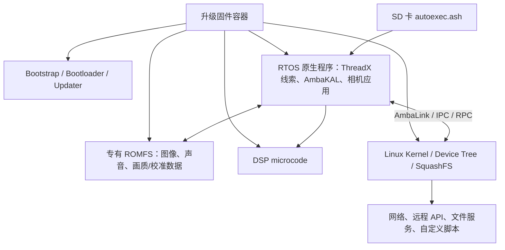

# YI 4K：RTOS 深度定制能力调查

日期：2026-11-05。对象为普通版 YI 4K / Z16，排除 4K+ / Z18 的地址和移植成果。用户当前目标是调查 RTOS 定制边界，防抖只是潜在用途之一。

**后续进展：已继续完成整份RTOS的自动静态分析与重点接口核对。最新结果、函数工程和二开步骤请读 [RTOS逆向手册](rtos-reverse-engineering.md)。以下保留本轮前期结构调查，末尾工具限制反映当时状态。**

## 1. 结论与证据等级

YI 4K 值得继续做 RTOS 逆向。它已经具备固件拆包/重打包、启动脚本、内存读写和可识别的原生代码入口；不必把研究局限于 Linux 服务。现实目标是**保留原厂启动、驱动、ThreadX/AmbaKAL 和 DSP 链路，在上面实现原生扩展**。

但要区分三个层次：

- **直接观察**：本次公开固件的结构、数据、校验、字符串、重打包结果。
- **社区已有成果**：项目源码、文档和发布说明展示的能力；本次没有在实体机复现。
- **工程推断**：根据前两者推导的移植路线；还没有可供用户直接运行的 YI RTOS 插件。

| 定制层次 | 当前依据 | 能力判断 | 剩余工作 |
|---|---|---|---|
| 编码/拍摄参数表 | YI 4K 对应版本的码率、分辨率 RAM 补丁 | 社区已有具体实现 | 逐版本核对地址、模式组合和稳定性 |
| RTOS 资源 | 本次提取 69 个 ROMFS 内容文件，重建字节一致 | 资源容器可处理，适合继续解析图片、声音、画质配置 | 单个资源格式、尺寸和内部校验仍需识别 |
| 局部逻辑补丁 | RTOS 原始 ARM 程序可提取，已有内存写入口 | 技术上有明确路径；本次未修改函数逻辑 | 反汇编、确认控制流及指令集，再做小范围验证 |
| 自定义 C/C++ payload、函数 hook | 找到候选命令分发表；Liemoth 在其他 Ambarella 机型有 loader | 有依据的移植方向，尚未在 YI 4K 打通 | 可执行内存、加载/触发、ABI、缓存和返回路径 |
| 自定义任务、菜单、拍摄状态机 | 固件保留 GUI、AmbaKAL、任务相关字符串；同平台有菜单项目 | 有机会深度扩展，需要恢复内部接口 | 调度、对象布局、事件队列、栈、同步、GUI 所有权 |
| 图像算法/处理链 | 独立 DSP 分区，RTOS 中有大量图像处理调用线索 | 可研究 RTOS 侧控制及参数；尚不能承诺可替换任意算法 | 结构体、调用时序、缓冲区、硬件能力和性能 |
| 替换 DSP 微码 | 能拆出 DSP 分区 | 容器可读不等于微码可开发 | 指令集、工具链、加载协议、硬件文档均未打通 |
| 完整开源固件、换 RTOS | 参考资料不是完整可构建的 YI SDK | 本次没有找到可复用的完整实现 | BSP、驱动、闭源库、启动链和实时行为需大量重建 |

## 2. 系统结构



`irungentoo` 的项目描述 RTOS 负责编码和机身界面，Linux 负责网络服务和转发控制。本次拆出的独立 RTOS、DSP、ROMFS 和 Linux 分区与这种架构相符。具体每项图像运算在哪个处理器执行，仍需逐项追踪，不能由这张架构图直接断言。

RTOS 是链接完成的整体原生程序。Linux 的 root 权限、可运行 Python，与能否安全调用 RTOS 内部函数不是同一项能力。`autoexec.ash` 由 RTOS Shell 执行，也不是 Linux Shell 脚本。

固件字符串出现 `ThreadX`、`AmbaKAL_TaskCreate` 等线索；DJI A9 资料还记录了链接 `libthreadx.a` 的构建方式。这支持把 ThreadX/AmbaKAL 作为恢复任务 API 的方向，但不构成 YI 精确 RTOS 版本、调度配置或源码已经恢复的证明。

## 3. 本次实际拆解的对象

来源：[psolyca/Yi_4k_ROOTFS v1.10.52](https://github.com/psolyca/Yi_4k_ROOTFS/releases/tag/v1.10.52)。这是**社区修改固件**，不能当作未经修改的官方原版或用户相机当前固件。

- 文件：`firmware_1.10.52.bin`
- 长度：59,188,220 字节
- SHA-256：`d24ce6c53fa2811fe42a11290c23cffbf8f3a1e9b66789a3a04d30db19549c5b`
- RTOS 中保留构建字符串：`Z16V13L_1.10.9_build-20180622051856_git-efbdfd85_r2748`
- 社区版本号与底层原厂构建号需要分别记录，不能用其中一个替代另一个。

使用 [psolyca 的 unpacker 分支](https://github.com/psolyca/Xiaomi_Yi_4k_Camera/tree/unpacker/firmware_unpacker) 进行拆解；具体提交见 `verification.json`。

| 分区 | 字节数 | 内容 |
|---|---:|---|
| bst | 4,096 | Bootstrap |
| bld | 55,676 | Bootloader |
| fw_up | 362,272 | 升级程序 |
| lrtos | 7,491,432 | RTOS 程序 |
| dsp | 4,038,656 | DSP 微码 |
| romfs | 12,943,360 | RTOS 资源容器 |
| lnx | 5,762,864 | Linux 内核 |
| fdt | 11,088 | Device Tree |
| rfs | 28,516,352 | Linux 根文件系统 |

验证结果：

1. 8 个主分区的数据 CRC 和累计 CRC 均通过，整包累计 CRC 也通过。FDT 是附在内核分区后的额外部分，由工具单独导出。
2. 无修改拆包→重打包后的整包，SHA-256 与原包相同，逐字节相等。
3. ROMFS 解出 69 个内容文件；所有文件 CRC 通过。70 个本地文件中另一个是工具生成的 `_header.a9t`。
4. ROMFS 无修改重建后与原分区逐字节相等。

解包器输出了一条 `Detection finished with unusual condition` 警告：其主头分区数量识别包含启发式判断。上面的 CRC 和字节往返结果对这份样本提供了额外验证；这不保证其他版本同样适用。

**以上证明容器解析和无修改重建可复现，不证明修改后的 RTOS 已能通过实体机升级检查、启动或长期稳定运行。** 校验工具处理的是 CRC；本次没有完整逆向启动链，不能扩大结论为所有校验、签名或权限机制均不存在。

## 4. RTOS 内已有的具体入口

### 4.1 启动脚本和 RAM 修改

[autoexec.ash 文档](https://github.com/irungentoo/Xiaomi_Yi_4k_Camera/blob/master/autoexec.ash/Readme.md) 给出了 `savebin`、`loadbin`、`writeb/writew/writel`，也给出 RTOS 发起 Linux 命令的 IPC 示例。

YI 4K `1.10.9` 已有的具体例子：

- [码率补丁](https://github.com/irungentoo/Xiaomi_Yi_4k_Camera/blob/master/bitrate/4k/1.10.9/autoexec.ash)：向 `0xA06D48BC` 等地址写浮点参数。
- [分辨率补丁](https://github.com/irungentoo/Xiaomi_Yi_4k_Camera/blob/master/4k/ultra_increased_resolution/1.10.9/autoexec.ash)：修改模式表中的宽高等值。

这些证明社区已经找到可修改的数据表，不等价于已经有任意原生代码加载器。能写数据、能改变程序控制流、能可靠执行自定义任务，需要逐步验证。

### 4.2 本次找到的候选命令分发表

RTOS 分区头的 `mem_addr=00100000`。社区反汇编文档给出的 RTOS 分析地址是 `0xA0100000`。本次在二进制里找到了与后一地址基准一致的名字指针和候选处理函数指针；不能把头部地址直接当作所有运行期指针地址。

在文件偏移 `0x5F2EA0` 起，观察到 38 条连续、步长 12 字节的候选记录，形如：

```
名字指针 / 候选处理函数指针 / 第三个字（这些记录为 0）
```

例子仅适用于本次哈希对应的 RTOS：

| 名字 | 记录文件偏移 | 候选处理函数地址 |
|---|---|---|
| help | 0x5F2F24 | 0xA02A44E0 |
| loadbin | 0x5F2F30 | 0xA02A2584 |
| ps | 0x5F2F6C | 0xA02A3864 |
| savebin | 0x5F2FD8 | 0xA02A3DB0 |
| t | 0x5F2FFC | 0xA029E1A4 |
| writel | 0x5F3044 | 0xA02A2E08 |

这是结构推断，不是反编译结果，也没有在相机上调用验证。其价值是提供一组很具体的下一步目标：反汇编 Shell 注册/分发逻辑、确认处理函数 ABI，再研究是否能增加命令或借用某个命令触发 loader。地址列表不是供直接写入实体机的补丁。

### 4.3 保留了丰富的字符串线索

RTOS 中可见 GUI 设置函数名、拍摄状态日志、AmbaKAL 任务/同步错误、图像处理调用和 Shell 命令名。选例：

- `AmbaShell Started`
- `AmbaKAL_TaskCreate Fail`
- `AmbaCache_Clean`、`AmbaCache_Invalidate`、`AmbaCache_Flush`
- `gui_set_eis`、`rec_connected_cam_settings_set_eis_enable`
- `AmbaDSP_ImgSetWarpCompensation:`
- `amba_app.elf`

这些是查找交叉引用的起点，不是完整符号表或可直接调用的函数声明。字符串出现不证明对应能力在当前模式启用，也不能恢复参数类型、结构体布局和线程调用约束。

## 5. 真正“深度定制”的可行路线

优先建立一个固定固件版本对应的 RTOS 扩展层：

1. **恢复内存与代码布局**：区分头部地址、运行期地址、代码、只读数据、可写数据、BSS、堆、栈与共享内存；确认 ARM/Thumb 状态和函数边界。
2. **恢复少量基础调用**：打印、文件读写、分配内存、延时、缓存维护。先确认 ABI、生命周期和错误行为。
3. **打通最小 loader**：从 SD 卡加载一段 ARM 原生代码，执行一个能观测结果且能够返回的操作。这里要验证可执行性、指令缓存、被覆盖指令和寄存器保存。
4. **建立按版本维护的函数 stub / 符号映射**：先让扩展复用原厂文件系统、驱动和消息通道；不能复制其他机型地址。
5. **恢复任务、消息和 UI 接口**：再考虑后台任务、按键事件、自定义菜单及拍摄状态机。
6. **最后研究图像处理链的控制接口**：能够控制已有硬件处理单元，通常比重写驱动或 DSP 微码更现实；实际能力要根据逆向结果和机上测量判断。

“可编译一个 ARM 程序”只完成了其中一小步。加载位置、任务上下文、可重入性、缓存、DMA、硬件缓冲区和实时期限，会决定它是否能与录像同时可靠运行。

RAM 扩展与永久修改 RTOS 分区应分别验证。先完成 RAM 中最小闭环，才能判断值得把哪些修改固化进可刷写固件。

## 6. 参考项目应如何使用

### 用户给出的三个项目

- [irungentoo/Xiaomi_Yi_4k_Camera](https://github.com/irungentoo/Xiaomi_Yi_4k_Camera)：直接用于了解启动脚本、RAM 参数补丁、固件分区、RTOS 日志、远程控制等已有入口。普通版和 4K+ 必须分开阅读。
- [psolyca/Yi_4k_ROOTFS](https://github.com/psolyca/Yi_4k_ROOTFS)：主要是修改 Linux RootFS 的固件工程，不是 RTOS 完整源代码。`build.sh` 还支持修改 RTOS 中的版本字符串，这也不能当作实现 RTOS 功能扩展的证据。
- [psolyca/Yi_4k_Events_Manager](https://github.com/psolyca/Yi_4k_Events_Manager)：Python 回调通过远程 API 控制相机；这属于已有动作的事件编排。不能把它当作能在编码或 GUI 内插入任意函数的 RTOS 插件系统。

ROOTFS README 提到的脚本名称有 `amba_fwpack_yi.py` 拼写差异；实际本次运行的是 `amba_fwpak_yi.py`。该项目构建依赖子模块、Linux 的设备节点和文件属性处理，Git 工作树本身不是可直接刷入的 RootFS。

### DJI / Ambarella A9

[o-gs/dji-firmware-tools](https://github.com/o-gs/dji-firmware-tools) 很有参考价值，而且 psolyca 的 YI 打包器和 ROMFS 工具在文件头明确说明借鉴自它，已经存在实际的工具复用关系。

- [amba_fwpak.py](https://github.com/o-gs/dji-firmware-tools/blob/master/amba_fwpak.py)：A9 分区、校验、重打包。
- [amba_sys2elf.py](https://github.com/o-gs/dji-firmware-tools/blob/master/amba_sys2elf.py) 和 [arm_bin2elf.py](https://github.com/o-gs/dji-firmware-tools/blob/master/arm_bin2elf.py)：把 raw ARM 程序包进便于分析的 ELF，不能恢复原源码。DJI 的代码/数据分界启发式不能原样套用到 YI。
- [amba_romfs.py](https://github.com/o-gs/dji-firmware-tools/blob/master/amba_romfs.py)：专有资源容器。
- [symbols](https://github.com/o-gs/dji-firmware-tools/tree/master/symbols)：特定 DJI 固件的 MAP/IDC，可为公共库识别提供线索，不能迁移绝对地址。
- [Firmware-m0100](https://github.com/o-gs/dji-firmware-tools/wiki/Firmware-m0100)：A9 的 ThreadX/Linux/DSP 分工，资料本身也将 DSP 格式细节列为未知。

“同 SoC”需要谨慎核对料号：[Phantom 3 板级资料](https://github.com/o-gs/dji-firmware-tools/wiki/WM320-Gimbal-top-board) 与 [Phantom 4 板级资料](https://github.com/o-gs/dji-firmware-tools/wiki/WM330-Camera-Encoder-board) 写 A9S75，而总体固件说明使用 A9SE 称呼。此次足以将其作为 A9 平台参考，不能据此认定它们与 YI 的具体料号、板级配置和固件可互换。

### Liemoth：最接近原生扩展方向的参考

[petabyt/liemoth](https://github.com/petabyt/liemoth) 描述了 Ambarella 相机上的 C/C++ 执行、交互菜单及模块方向。

其 `src/loader.S`、`src/Loader.ash`、`src/main.S` 和 `platform/` 展示了：用启动脚本写入 loader，复用内部文件和内存函数，并以固件相关的跳转入口运行自定义程序。

这比网络控制脚本更接近我们要研究的 RTOS 扩展。但 README 的测试机为 Activeon DX 和 GoPro Hero 3+，A9/A12 移植仍列作目标；没有证据表明它已经支持 YI 4K。它是设计和移植参考，不是 YI 即用 SDK。

## 7. 尚未回答的问题与下一轮验收标准

| 问题 | 当前状态 | 如何获得可靠答案 |
|---|---|---|
| 能否完整拆出并无损重建这份固件？ | 已回答：可以 | 已保存 CRC 和字节比对结果 |
| 能否修改 RTOS 的数据表？ | 社区有 YI 对应版本实现 | 在目标相机和目标版本复现 |
| 能否加载自定义原生程序？ | 有候选入口，未在 YI 验证 | 定位分发函数，做可返回的最小 payload |
| 能否创建任务、扩展 GUI？ | 部分线索，未打通接口 | 恢复 ABI、对象和调度模型后验证 |
| 是否需要/能够绕过其他启动检查？ | 未完整分析 | 追踪 updater、bootloader 与 RTOS 加载过程 |
| 能否改 DSP 算法或替换整个 RTOS？ | 当前证据不足 | 另需工具链、底层接口和大量硬件验证 |
| 当前相机的固件和硬件变体是否匹配样本？ | 未知 | 读取机身型号、固件版本与构建标识 |

下一轮最有价值的成果不是先选一个大功能，而是：**在指定 YI 4K 固件上，证明自定义原生代码可以加载、执行、调用少量内部服务并正常返回，同时保持原厂相机功能可用。** 这项结果才能把“理论上能深改”推进到实际可维护的扩展平台。

本次工具限制：REA 未接入可用的原生分析引擎，诊断也报告当前 Node 版本不受其支持。因此本次完成的是项目源码阅读、Python 工具拆包、原始字节/字符串/指针结构检查，没有生成反编译结果或执行时证据，也没有更改用户工具配置。后续要恢复完整调用图，还需要可用的 ARM 反汇编/反编译环境。
