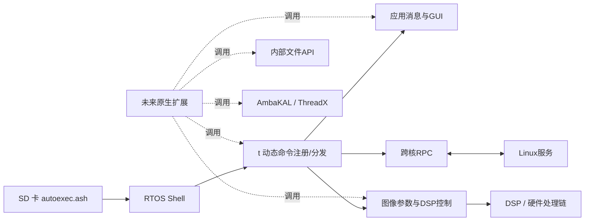

# YI 4K RTOS 逆向结果与二次开发手册

本次目标是分析整份 RTOS，并回答“原厂已有的哪些实现可供二开复用”。已完成全映像自动静态分析及基础接口、命令注册、应用控制、图像/IPC 的重点人工核对；尚未完成全部函数的语义恢复或真机验证。本文和每份子报告都区分代码观察、候选 ABI 与未知项。

## 1. 先读结论

这份 RTOS 可以作为原生扩展的基础继续研究。它已经有可复用的命令注册器、内部文件 API、ThreadX/AmbaKAL 任务与内存服务、应用消息路由、GUI 服务，以及 DSP 图像参数和跨核 RPC 接口。适合保留这些实现，在其上建立按固件版本维护的扩展层。

目前还不能称为可用的第三方 SDK：**原生代码的首次加载/执行、I-cache 与多核一致性、可执行内存所有权和初始化时机仍未在 YI 4K 上验证。** 因而本次没有提供“复制到卡里就能运行”的 payload 或可刷写修改固件。

交付包括：

- 全映像 Ghidra 工程：`artifacts/rtos-reverse/ghidra-project/yi4k.gpr`。
- 全函数索引、逐函数伪代码、汇编和交叉引用：`artifacts/rtos-reverse/full/`。
- 25 项基础接口说明：`artifacts/rtos-reverse/core/`。
- 4 套命令表的 113 项处理函数、22 处直接根命令注册：`artifacts/rtos-reverse/tables/`。
- 图像和跨核 IPC 实现：`artifacts/rtos-reverse/image-ipc/`。
- 候选 ABI 头文件及可编译的集成示例：`sdk/`。
- 可复现提取、反汇编和 Ghidra 导出脚本：`scripts/`。
- 1.10.7 Shell 内存访问、DMA 搬运、I-cache 候选和 `t` 注册边界：
  [device-1107-shell-memory-and-registration.md](device-1107-shell-memory-and-registration.md)。
- 任务创建→核心排除→resume 的固定包装与调用范围：
  [device-1107-task-launch-path.md](device-1107-task-launch-path.md)。
- 1.10.7 RPC 注册、26 个 procedure 回调与注销生命周期：
  [device-1107-rpc-extension-contract.md](device-1107-rpc-extension-contract.md)。
- 主控制任务描述符、退出消息和启动资源：
  [device-1107-task-trampoline.md](device-1107-task-trampoline.md)。
- 对齐 A32 指令缓存失效扫描、BOSS/MMU 恢复边界与静态启动补丁方向：
  [device-1107-code-publication.md](device-1107-code-publication.md)。
- 启动补丁的具体空间/调用点候选、96 字节离线原型和恢复缺口：
  [device-1107-static-boot-extension.md](device-1107-static-boot-extension.md)。

本次识别 **11,035 个函数候选入口**，生成 **11,031 份伪代码**；4项仍失败，分别涉及响应体过大、超时和符号分组错误。全部保留汇编与失败记录。最终统计见 [coverage.json](../artifacts/rtos-reverse/full/coverage.json)。函数发现可能有误识别，反编译成功的数量也不代表这些函数已经全部人工理解。

## 2. 固件身份与分析方法

| 项目 | 固定值 |
|---|---|
| 硬件对象 | 普通 YI 4K / Z16，排除 YI 4K+ |
| 公开样本 | psolyca 社区 v1.10.52，未从用户实体机读取 |
| RTOS 文件 | `artifacts/firmware/v1.10.52/_part_lrtos.a9s` |
| 文件长度 | 7,491,432 字节 |
| RTOS SHA-256 | `c1cde4bcd290bdfac9f48ad5eb04f20bc3d208dd1e041ac1376b255dcf846141` |
| 内部构建字符串 | `Z16V13L_1.10.9_build-20180622051856_git-efbdfd85_r2748` |
| 映像分析地址 | `0xA0100000`，结束于 `0xA0824F67` |
| 处理器模式 | little-endian ARMv7；A32 主体及部分 Thumb 库代码 |
| 分析工具 | Ghidra 12.2 PUBLIC、Capstone 5.0.7、Python 原始字节检查 |

Ghidra 原始二进制项目的 `image_base` 元数据保留为 0，但实际映像内存块从 `0xA0100000` 开始，不能据此把函数地址减到 0。分区头的 `mem_addr=0x00100000` 与运行期虚拟指针也必须分开记录。

本次 REA 没有可用的原生引擎，采用正常 Ghidra headless 和 Capstone 离线分析。Ghidra 的 macOS 反编译器从官方发行包所附源码编译，没有修改用户的 MCP 配置。工具方法属于离线静态证据，没有产生设备执行证据。

先前已验证升级整包、ROMFS 无修改往返均逐字节一致；参见 [前期结构调查](rtos-customization.md)。这证明这份样本的容器可复现，不代表修改后已通过刷机和启动验证。

## 3. 代码、状态与内存模型



启动入口 `0xA0100000` 跳转到 `0xA01000FC`。该启动流程包含清零循环，其地址常量位于文件偏移 `0x22C`、`0x230`，分别是 `0xA0FB3000`、`0xA1A51178`。循环实现支持将 `[0xA0FB3000, 0xA1A5117C)` 记录为 BSS 候选；Ghidra 细化工程加入了对应未初始化内存块。

这段状态区包含命令注册锁/池、相机设置和驱动对象等全局地址。映像尾部到 BSS 之间的空洞、BSS 范围或某段全零数据，都不能直接视为 payload 可占用的空闲 RAM。实际堆、栈、DMA 缓冲区、DSP 共享区和 Linux 共享内存仍需恢复所有权。

ThreadX 的创建检查、任务魔数与 AmbaKAL 包装层已从代码核对。部分 libc 实现在 Thumb 中：以函数指针调用时必须使用带 bit 0 的地址，不能把所有函数都按 A32 `BL` 处理。

## 4. 最先值得封装的基础接口

详细参数、指令依据及限制在 [基础实现报告](../artifacts/rtos-reverse/core/findings.md) 和 [25 项接口目录](../artifacts/rtos-reverse/core/interfaces.json)。下表是二开时最常用的起点，名称为分析者重建标签。

| 实现 | 地址 | 已恢复的参数形态 | 重要限制 |
|---|---|---|---|
| 注册 `t` 子命令 | `0xA029E098` | `(name, handler)` | 名字最多19字节；handler必须常驻；分配失败路径有锁问题 |
| 内部 fopen | `0xA032E0C8` | `(path, mode)` → opaque file | 不可混用工具链的 `FILE` |
| fclose | `0xA032E0D0` | `(file)` | 通过原厂接口关闭 |
| fread / fwrite | `0xA032E0D4` / `0xA032E0D8` | `(buffer,size,count,file)` | 四个32位参数，不套用其他机型签名 |
| 创建任务 | `0xA03BC2BC` | task/name/priority/entry/arg/stack/size/autostart | 8参数；对象生命周期、栈及调用上下文仍需验证 |
| 休眠 | `0xA03BC320` | `(raw_ticks)` | 未实测 tick 频率，不能直接把数值当毫秒 |
| 当前任务 | `0xA03BC384` | `()` → opaque task | 需要正确的CPU/任务上下文 |
| 池分配 / 释放 | `0xA03BC6DC` / `0xA03BC714` | `(pool,&out,size,timeout)` / `(original_ptr)` | 必须使用已初始化且归属明确的池 |
| 对齐分配 | `0xA029A7D8` | `(pool,&aligned,&original,size,alignment)` | 释放 original，不是 aligned |
| D-cache clean | `0xA0498728` | `(address,bytes)` | 不等同于完整代码缓存同步 |
| D-cache invalidate / flush | `0xA049878C` / `0xA04987F0` | `(address,bytes)` | 低层观察到32字节缓存行 |
| strcmp / strlen | `0xA04F9745` / `0xA04F99F1` | 常见字符串参数 | 表中为已置 Thumb bit 的函数指针地址 |

TaskCreate 包装层将8参数转排给 ThreadX 检查层：抢占阈值=priority、time-slice=0、对象大小参数=`0xD8`。这不意味着可以直接复制其他 ThreadX 版本的 `TX_THREAD` 结构。头文件使用 opaque 指针保留未知布局。

`loadbin` 的行为也已核对：解析目的地址，打开文件，把字节读到该地址，再关闭文件。它不负责分配目标内存，不执行代码，也没有完整指令缓存处理，因此不能把“loadbin 成功”当作 loader 已完成。

## 5. 原厂的扩展接入机制

普通 Shell handler 的寄存器约定为 `r0=argc`、`r1=argv`、`r2=printf-like callback`。打印回调的确切返回类型尚未确认。

`t` 注册器 `0xA029E098` 创建12字节节点：

```c
struct candidate_t_command {
    const char *name;  // 复制到原厂池
    void *handler;    // 保存原始代码指针
    struct candidate_t_command *next;
};
```

根哨兵为 `0xA06F3070`。分发器 `0xA029E1A4` 匹配名字，然后调用 `handler(argc-1, argv+1, print)`，所以注册为 `userdemo` 的 handler 收到的 `argv[0]` 是 `userdemo`。

这提供了真实的原生集成入口，但不能解决首次执行：必须先有能运行初始化函数的 loader 或经核实的启动 hook。注册器也没有提供此次已确认的 unregister 路径，因此原生代码不能在命令仍挂在链上时卸载。

注册器的两处分配失败分支绕过了解锁。即使原厂提供了接口，也应在内存池充足、初始化完成、可恢复的条件下做首次实验；后续需要修复失败路径或构建自己的可靠包装。

## 6. 应用、GUI 和拍摄逻辑能复用什么

[命令表报告](../artifacts/rtos-reverse/tables/findings.md) 给出完整名称、函数地址、结构和参数偏移。[command-tables.json](../artifacts/rtos-reverse/tables/command-tables.json) 为机器可读索引。

| 命令树 | 结构/项数 | 可研究的实现 |
|---|---|---|
| 普通 Shell | 38项候选表 | 文件、内存读写、任务查看、加载/保存二进制 |
| `t app` | strcmp 分支树 | 应用消息、按键、插拔事件、sensor、音频与省电控制 |
| `t ants` | 69项、每项8字节 | 产品调试、GUI、触摸、配置、预览、RTMP、板级测试 |
| `t img` | 17项、每项12字节 | 图像调试、warp、MCTF、rawenc、highiso、统计等 |
| `t ipc` | 6项、每项8字节 | RPC、rpmsg、跨核锁、文件服务 |
| `t drv` | 21项、每项12字节 | GPIO/I²C/SPI/UART/PWM/DMA/GDMA/cache 等 |

`t app` 和 `t ants` 是两套不同实现。不能把工厂调试表的名称当作稳定的高层 API，也不能统一套用 argc/argv 偏移：

- ants 子处理函数：`argc-2, argv+2, print`。
- ipc、drv 子处理函数：`argc-1, argv+1, print`。
- img 子处理函数：保留父函数的 argc/argv。

已经找到可进一步封装的底层候选：

| 能力 | 底层入口 | 代码依据与边界 |
|---|---|---|
| 应用消息 | `0xA01E6598(msg,p1,p2)` | `t app msg` 解析三个数值后调用；消息ID和状态条件需逐项恢复 |
| GUI 文本 | `0xA01996C8(line,text,1)` | `show_str` 的实际调用；显示持续时间、覆盖层及线程所有权待验证 |
| 视频模式设置 | `0xA01A63D4(str,print)` | set_video_res 的转调路径；依赖原厂模式与能力检查 |
| PAL/NTSC等标准 | `0xA01A61A4(str,print)` | 原厂配置路径 |
| 照片模式 | `0xA01A62BC(str,print)` | 原厂配置路径 |
| 取景切换 | `0xA01E659C(0xD8090008,p1,p2)` | vf_switch 通过消息服务控制，不是直接操作帧缓存 |
| RTMP 协调 | `0xA012FBEC()`；停止链 `0xA012F324/0xA012FD20` | 复用原有跨系统协调链；包装返回0不证明底层成功 |
| Gyro驱动对象 | 全局 `0xA1A355A4`，ops+0xC | 只确认 chip_id 调用，不代表原始数据接口已恢复 |

应该优先调用原厂消息/设置路径，研究其线程、状态和完成事件；直接写内存可能跳过模式校验、持久化和缓冲区重建。

## 7. 图像处理与 DSP 控制的具体发现

详见 [图像与IPC报告](../artifacts/rtos-reverse/image-ipc/findings.md)。本次定位的是 ARM 侧控制与参数实现，没有反编译独立 DSP 微码。

后续 EIS 专项已进一步定位两个专门任务、gyro 数据读取、采样与偏置处理、旋转/逐行网格生成以及实际 DSP warp 提交链，参见 [EIS 实现与替换边界](eis-reverse-engineering.md)。该专项补充了早先仅确认 chip_id 的 gyro 入口；未改变真机执行与完整 ABI 尚待验证的限制。

warp 链中的高价值入口：

| 入口 | 地址 | 静态观察 |
|---|---|---|
| CalcWarpCompensation | `0xA03119A8` | 使用约0xC0字节描述结构；检查版本、网格、sensor几何、采样因子及warp指针 |
| SetWarpCompensation | `0xA0312460` | 复制H/V网格、clean缓存，再向现有DSP控制链提交 |
| GetWarpCompensation | `0xA031282C` | 读取当前warp描述信息 |

这些代码说明“复用已有硬件变换链、改变上层算法生成的参数”有具体研究入口。它们不证明任意算法可以移植：还需恢复网格结构、帧绑定、缓冲区寿命和实时预算。

MCTF链也有实际 get/set 实现，涉及 enable、compression、ZMV、ghost 等参数。调试load/save路径使用固定0x6BD0字节缓冲区，加载后有复制和D-cache clean。不要把该长度或结构推广到其他版本、模式或处理管线。

## 8. 与 Linux 互操作

IPC 调试代码能创建指向 Linux 服务的 RPC client，使用 host=0、program=`0x20000001`、version=1。已经定位：

- 创建：`0xA03C4E94`。
- 通用 RPC call：`0xA03C4F40`。
- 销毁：`0xA03C4C1C`。
- 命令执行包装：`0xA03C9188`、`0xA03C91D0`。

同步执行包装使用 procedure=1、输出上限0x800、timeout=5000；另一包装走procedure=2异步方式。后续 [Linux专项](linux-system-analysis.md) 已在 `util_svc` 指令中核实Exec1使用popen/fgets、Exec2使用system，并恢复remoteapi/RTSP/Telnet的跨系统启动、事件与SharePreview服务；完整字节序和任务阻塞约束仍待核实。

原厂 exec 调试命令存在小型固定缓冲区及无界字符串拼接，不应直接作为自己的网络可访问接口。二开可以复用RPC机制，并定义有边界的命令/数据协议；实时图像循环不应依赖慢速同步 Shell/RPC。

## 9. 已确认的陷阱

1. **命令空壳**：`set_video_split_size` 的13个参数里，12个只打印成功并返回0；只有 `30G` 写入设置对象的16位字段。这个字段是否被录像链消费仍需追踪。
2. **错误路径缺锁释放**：动态 `t` 注册器两处分配失败跳过mutex unlock。
3. **参数检查不完整**：show_str handler 检查 argc>0，却访问 argv[1]；二开包装必须补参数检查。
4. **GUI命令与名字不符**：chg_gui 的 setting/preview/其他分支行为并不符合直觉，必须按实际控制流处理。
5. **打印和返回0不是完成事件**：预览、RTMP、设置等命令可能只发消息或忽略下游错误。
6. **缓存不能省略**：数据缓存clean不等于代码可执行；I-cache、多核、DMA和缓冲区所有权需要分别处理。
7. **跨版本地址不可复用**：社区版本号、内部构建号和分区哈希必须一起记录。普通4K与4K+更不能混用地址。

## 10. 下一步二开顺序和验收标准

| 阶段 | 工作 | 验收结果 |
|---|---|---|
| 0. 对齐实体机 | 读取型号、固件/构建号、保存原版升级包；核对RTOS哈希 | 确认本报告地址适用，或先完成版本迁移 |
| 1. 建立观察路径 | 用已有Shell/日志入口观察启动、命令和任务 | 能可靠记录结果、识别重启和错误 |
| 2. 最小原生执行 | 定位可执行内存、启动触发、A32/Thumb状态和缓存流程 | 自定义函数进入、打印、返回，原厂录像仍正常 |
| 3. 注册自定义命令 | 初始化后调用原厂注册器；补错误与参数处理 | `t userdemo`可调用自己的handler，重复运行不泄漏 |
| 4. 原厂服务封装 | 先文件、休眠、池；再任务、消息、GUI | 每项有输入边界、错误返回、上下文和生命周期说明 |
| 5. 功能原型 | 用封装层实现一个小功能，观察状态和资源 | 录像/休眠/插拔等场景下可重复验证 |
| 6. 固化与分发 | 最后再考虑永久RTOS补丁和升级包 | 校验、启动、回退和长时间稳定性实测通过 |

阶段2仍是当前缺口。不要跳到阶段6，也不要把 ELF、Linux 可执行文件、raw RTOS payload 和整包固件混为一谈。

### 最小示例的用途

`sdk/examples/hello.c` 展示将本地 handler 注册为 `t userdemo` 的形态；`sdk/yi4k_11052_internal.h` 保存静态重建的 ABI。

示例只编译为 relocatable ARM object：

```sh
clang --target=armv7-none-eabi -mcpu=cortex-a9 -marm -mfloat-abi=soft \
  -ffreestanding -fno-builtin -fno-stack-protector -fno-pic -O2 \
  -Wall -Wextra -Werror -c sdk/examples/hello.c \
  -o artifacts/rtos-reverse/example-hello.o
```

它没有链接地址、加载器、完整cache处理或运行期哈希检查，不是可刷写或可直接运行的产物。未来loader需要先验证映像身份、代码/数据重定位及内存边界，再在已初始化任务上下文调用 `yi4k_example_init()`。handler常驻期间不得卸载其代码。

## 11. 如何继续查代码

不打开Ghidra也能查询：

```sh
python3 scripts/rtos_query.py function shell_loadbin
python3 scripts/rtos_query.py function 0xA029E098
python3 scripts/rtos_query.py strings WarpCompensation
python3 scripts/rtos_query.py callers 0xA032E0D4
python3 scripts/rtos_query.py callees 0xA02A2584
python3 scripts/rtos_query.py xrefs 0xA05AE6D8
python3 scripts/rtos_query.py asm 0xA029E098 --limit 60
```

`callers/callees` 是静态直接调用/跳转记录；函数指针调用和动态注册不会全部自动解析。`functions.json` 的签名可能是推断值，特别是 `undefined`、`void` 和参数个数，必须回到指令和调用点核对。命令表、手工接口目录和全局反编译索引应结合使用。

Ghidra工程可以在匹配版本的GUI中打开。第一次使用如果本机没有原生反编译组件，需要按该版本官方说明构建。复现命令和分析环境记录见 `artifacts/rtos-reverse/analysis-manifest.json`；不要将工具安装目录或临时路径当成固件的一部分。

## 12. 完成度与未完成事项

| 范围 | 本次状态 |
|---|---|
| 整份RTOS文件身份、结构及字符串索引 | 完成离线提取 |
| 全映像函数发现、汇编、交叉引用、逐函数反编译尝试 | 完成自动静态一轮；失败项保留 |
| Shell与t注册、基础文件/任务/内存/cache | 完成重点指令核对和候选ABI整理 |
| 应用/GUI/拍摄命令映射 | 完成明确注册表和若干调用链；大量事件语义仍待恢复 |
| Warp/MCTF/IPC | 完成选定控制入口、参数与数据流分析；非全量算法恢复 |
| 完整原始符号、类型、结构体、源代码 | 未恢复；伪代码不是原始源码 |
| 首次原生执行、可执行内存和完整I-cache协议 | 未真机验证 |
| DSP微码、全传感器/板级驱动、全部调度行为 | 未完成专项逆向 |
| 可刷写自定义RTOS与稳定性 | 未制作或验证 |

这是一份可以继续开发和核验的静态逆向工程，不是宣称原厂软件已百分之百恢复。下一步的关键验收是原生扩展最小执行闭环，再逐项把候选接口升级为经过测试的接口。
